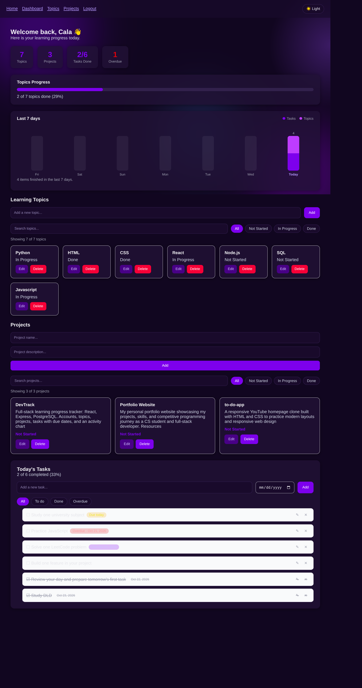
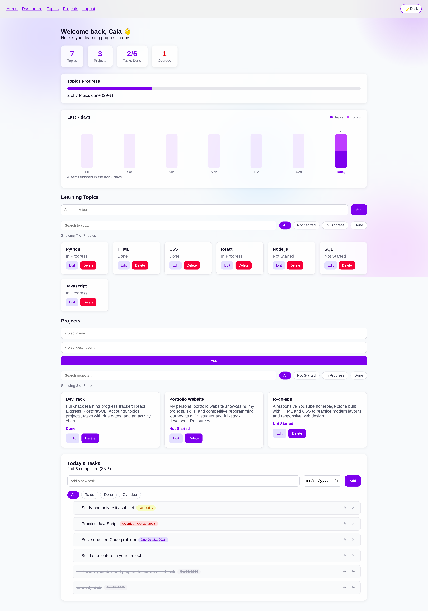
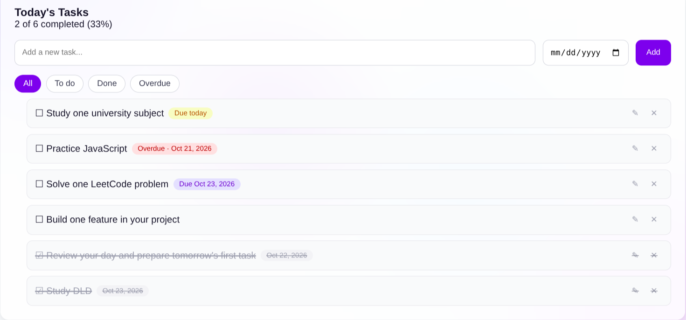
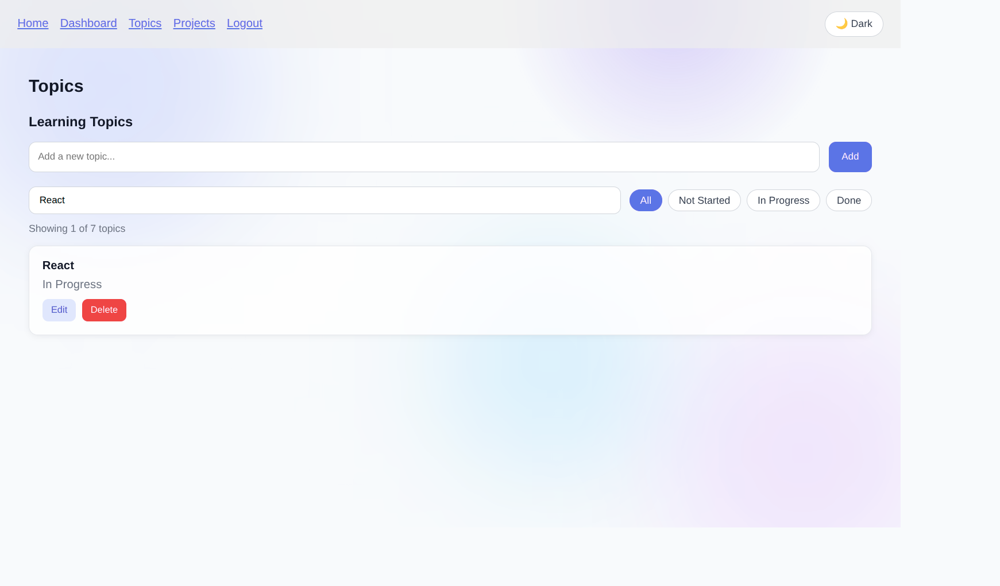
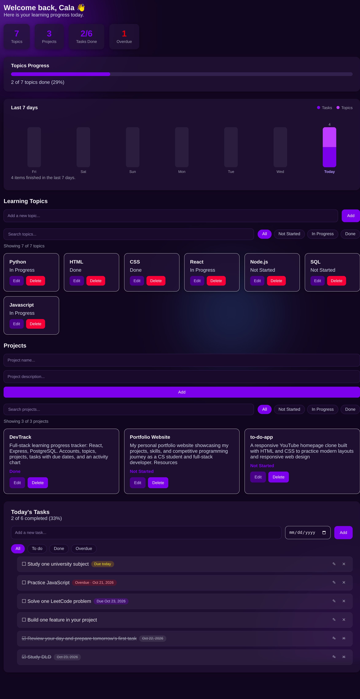

# DevTrack

A full-stack learning progress tracker for developers. Create an account, list the topics you're studying, track your side projects, and keep a daily task list with due dates. Every account has its own private data.

**Live app:** https://dev-track-vert.vercel.app

> The backend runs on a free hosting plan that goes to sleep when idle. The first request after a quiet period can take 30-50 seconds. After that it responds normally.

## Screenshots

| Dashboard (dark) | Dashboard (light) |
|---|---|
|  |  |

| Tasks with due dates | Search, filters, and editing |
|---|---|
|  |  |

**On a phone**



## Features

- **User accounts**: register and log in, with passwords stored as bcrypt hashes
- **Private data**: each account only ever sees its own topics, projects, and tasks
- **Protected pages**: the dashboard, topics, and projects pages are only open to logged-in users, and an expired session sends you back to the login page and then to the page you wanted
- **Learning topics**: add, rename, delete, and click a topic to cycle its status (Not Started → In Progress → Done)
- **Topic categories**: group topics under HTML, CSS, JavaScript, or any name you choose, filter by category, and see a progress bar for each one
- **Projects**: track side projects with a name, description, and status, and edit them in place
- **Daily tasks**: add, edit, complete, and delete tasks, with To do / Done / Overdue filters
- **Drag-and-drop ordering**: reorder topics, projects, and tasks by dragging, with mouse, touch, or keyboard, and the order is saved
- **Due dates**: give tasks an optional due date and get Overdue, Due today, and upcoming labels, plus an Overdue counter on the dashboard
- **Streaks**: see how many days in a row you finished something, and your longest streak
- **Activity chart**: a 7-day bar chart of the tasks and topics you finished each day, grouped by your own time zone
- **Search and filters**: search topics and projects by text and narrow them by status
- **Inline editing**: edit any item directly on its card, with Enter to save and Esc to cancel
- **Light and dark theme**: a toggle that remembers your choice and starts from your system preference
- **Interactive background**: slowly drifting color shapes and a glow that follows the mouse (turned off for users who prefer reduced motion)
- **Responsive layout**: works on phones, tablets, and desktops
- **Instant feedback**: toast messages confirm every action and explain any error
- **Real progress bar**: calculated from how many of your topics are marked Done
- **Loading and error states**: clear messages while data loads or if the server can't be reached
- **Protected API**: the backend rejects any request without a valid login token

## Tech stack

| Layer | Technology | Hosted on |
|---|---|---|
| Frontend | React (Vite), React Router, dnd-kit, plain CSS | Vercel |
| Backend | Node.js, Express | Render |
| Database | PostgreSQL | Neon |
| Auth | bcryptjs (password hashing), jsonwebtoken (JWT) | |
| Protection | express-rate-limit, CORS restricted to the frontend domain | |

## Architecture

```
React app (Vercel)
      │  fetch() with  Authorization: Bearer <token>
      ▼
Express API (Render)
      │  rate limiting, then requireAuth middleware verifies the token
      ▼
PostgreSQL (Neon)
      users ─┬─ topics  (status, category, position, completed_at)
             ├─ tasks   (done, due_date, position, completed_at)
             └─ projects (status, position)
```

Every topic, task, and project row has a `user_id` linking it to its owner, and every query filters by the logged-in user's id.

The backend talks to Postgres through Neon's serverless driver (`@neondatabase/serverless`), which sends queries over HTTPS instead of a direct TCP connection. This works on networks that block the standard Postgres port. A small wrapper in `server/db.js` retries a query a few times when the database can't be reached, so a brief network hiccup doesn't show up as an error.

On the frontend, a small `api()` helper in `src/api.js` attaches the login token to every request and turns server errors into readable messages, and a `ToastContext` shows them to the user. Route guards in `src/components/RouteGuards.jsx` keep logged-out visitors off the private pages, and a `401` response from the API clears the stale login and redirects to the login page. The real protection is always on the server, which checks every request.

Ordering is stored in a `position` column. Dragging an item sends the full new order to `PUT /reorder/:table`, and new items are added to the end of the list.

The activity chart and the streak both read `completed_at` timestamps. The browser sends its time zone with the request, so a task finished late in the evening is counted on the correct local day.

## API endpoints

| Method | Route | Description | Auth |
|---|---|---|---|
| POST | `/register` | Create an account, returns a token | No |
| POST | `/login` | Log in, returns a token | No |
| GET | `/topics` | List your topics in your saved order | Yes |
| POST | `/topics` | Add a topic (optional `category`) | Yes |
| PUT | `/topics/:id` | Cycle a topic's status | Yes |
| PATCH | `/topics/:id` | Edit a topic's title and/or category | Yes |
| DELETE | `/topics/:id` | Delete a topic | Yes |
| GET | `/projects` | List your projects in your saved order | Yes |
| POST | `/projects` | Add a project | Yes |
| PUT | `/projects/:id` | Cycle a project's status | Yes |
| PATCH | `/projects/:id` | Edit a project's name and description | Yes |
| DELETE | `/projects/:id` | Delete a project | Yes |
| GET | `/tasks` | List your tasks in your saved order | Yes |
| POST | `/tasks` | Add a task (optional `dueDate`) | Yes |
| PUT | `/tasks/:id` | Toggle a task done / not done | Yes |
| PATCH | `/tasks/:id` | Edit a task's title and/or due date | Yes |
| DELETE | `/tasks/:id` | Delete a task | Yes |
| PUT | `/reorder/:table` | Save a new order (`topics`, `projects`, or `tasks`) from `{ ids: [...] }` | Yes |
| GET | `/activity?days=7&tz=...` | Tasks and topics finished per day, for the chart | Yes |
| GET | `/streak?tz=...` | Current and longest streak of active days | Yes |

## Run it locally

You need Node.js and a free PostgreSQL database (for example from [Neon](https://neon.com)).

**1. Backend**

```bash
cd server
npm install
```

Create a file named `server/.env` containing:

```
JWT_SECRET=a_long_random_string
DATABASE_URL=your_postgres_connection_string
```

Generate a random secret with:

```bash
node -e "console.log(require('crypto').randomBytes(32).toString('hex'))"
```

Create the tables (run once on a new database), then start the server:

```bash
node setup-db.js
npm run dev
```

The API runs on `http://localhost:5000`. The `dev` script starts the server with network options that help on slow connections to a distant database region. `npm start` runs the plain version, which is what production uses.

If you already have a database from an earlier version of this project, add the newer columns instead of running the setup again:

```bash
node migrate-due-dates.js
node migrate-completed-at.js
node migrate-categories.js
node migrate-positions.js
```

**2. Frontend**

In a second terminal, from the project root:

```bash
npm install
npm run dev
```

The app runs on `http://localhost:5173`.

## Environment variables

| Variable | Where | Purpose |
|---|---|---|
| `JWT_SECRET` | Backend | Signs and verifies login tokens |
| `DATABASE_URL` | Backend | PostgreSQL connection string |
| `FRONTEND_URL` | Backend (production) | The only website allowed to call the API |
| `TRUST_PROXY` | Backend (production) | How many proxy servers sit in front of the API, so rate limiting sees each visitor's real address |
| `VITE_API_URL` | Frontend (production) | Address of the backend API |

Secrets are never committed. `server/.env` is listed in `.gitignore`.

## Known limitations

- The free backend sleeps when idle, so the first request can be slow.
- No password reset or email verification.
- The login token is stored in the browser's `localStorage`.
- Rate-limit counters live in server memory, so they reset when the server restarts.
- The activity chart and streak only count items finished after completion tracking was added, so older items don't appear.
- Reordering works on the full list only, not while a search or filter is active.
- No automated tests yet.

## What this project demonstrates

The complete request lifecycle of a real web application: a click in React becomes a `fetch` call, travels to Express, is rate limited and authenticated by middleware, reads or writes a SQL database, and returns JSON that updates the UI, with all data scoped to the logged-in user and the whole stack deployed online.